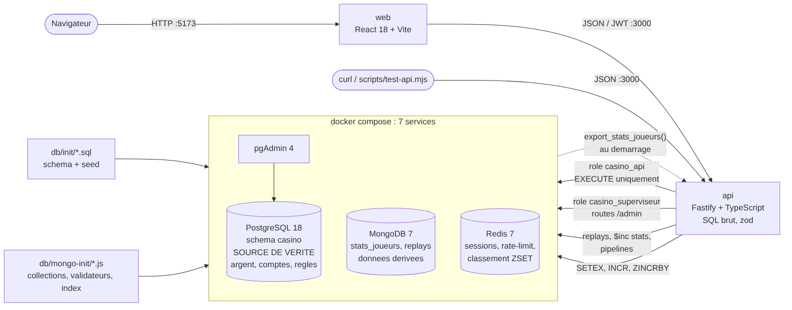
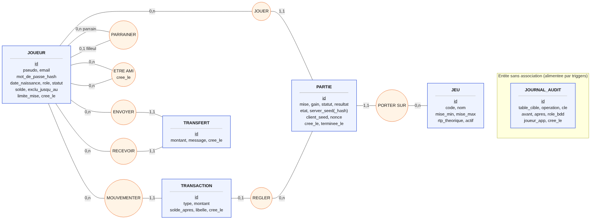
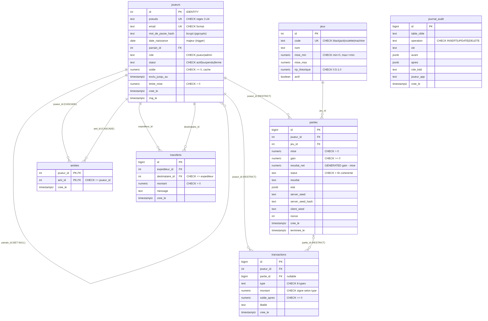
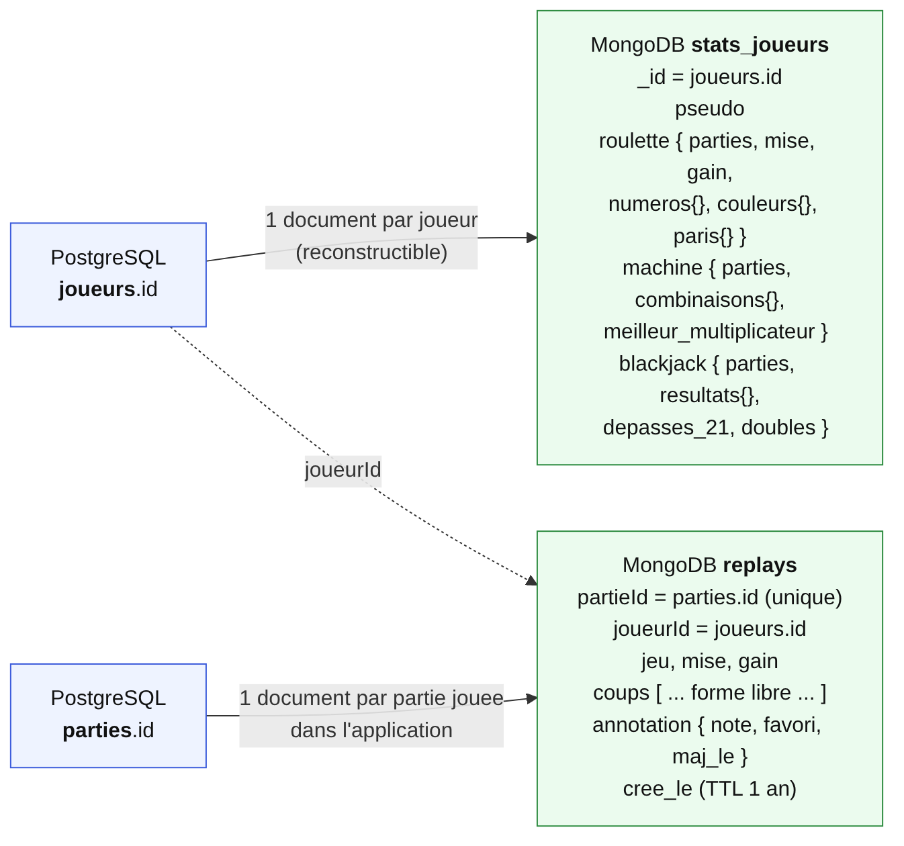

# Casino — document de présentation

Projet final *Bases de données relationnelles et non relationnelles*, Mastère 1 Développement, EFREI.

Sommaire :

1. [Le projet](#1-le-projet)
2. [Architecture](#2-architecture)
3. [Modèle relationnel : MCD, MLD, MPD](#3-modèle-relationnel--mcd-mld-mpd)
4. [Modèle non relationnel](#4-modèle-non-relationnel)
5. [Justification des choix techniques](#5-justification-des-choix-techniques)
6. [Exemples de requêtes](#6-exemples-de-requêtes)
7. [Index et performance](#7-index-et-performance)
8. [Stratégie de sauvegarde](#8-stratégie-de-sauvegarde)
9. [Limites et pistes d'amélioration](#9-limites-et-pistes-damélioration)

---

## 1. Le projet

### Contexte

Un casino en ligne fictif, avec trois jeux : la roulette européenne, une machine à sous à trois rouleaux et le blackjack. Le sujet a été choisi parce qu'il mélange deux natures de données très différentes :

- **l'argent** (mises, gains, soldes, dépôts, transferts) : il exige l'exactitude, les transactions, des contraintes qu'aucun client ne peut contourner, et une traçabilité complète ;
- **le comportement de jeu** (numéros sortis, combinaisons obtenues, déroulé d'une main) : sa forme change d'un jeu à l'autre, il est volumineux, rarement joint et reconstructible.

Ces deux natures justifient deux familles de bases (voir [§5](#5-justification-des-choix-techniques)).

### Utilisateurs

| Profil | Ce qu'il fait | Rôle PostgreSQL utilisé par l'API |
|---|---|---|
| Joueur | s'inscrit, dépose, joue, consulte son historique, ses statistiques et ses replays, gère ses amis, fixe ses limites de jeu responsable | `casino_api` |
| Administrateur | contrôle l'intégrité du grand livre, consulte l'audit, rafraîchit la vue matérialisée, détecte la collusion, surveille les gros gagnants | `casino_superviseur` |
| Analyste (hors application) | lit les agrégats, jamais de données personnelles | `casino_analyste` |

### Fonctionnalités principales

- Inscription réservée aux majeurs, avec bonus de bienvenue et parrainage, en une seule transaction.
- Trois jeux *provably fair* : le hash du tirage est publié avant la partie, et le joueur peut vérifier le résultat après coup.
- Portefeuille : dépôt, retrait, transfert atomique entre joueurs.
- Jeu responsable : auto-exclusion (qui ne peut qu'être allongée), plafond de mise (qui ne peut que baisser).
- Statistiques personnelles : l'argent vient de PostgreSQL, le comportement de MongoDB.
- Replays des parties, annotables (note, favori) et supprimables.
- Amis : ajout et suppression.
- Classements : exact (PostgreSQL), temps réel (Redis) et quotidien (vue matérialisée).
- Back-office : intégrité, audit, index, requêtes lentes, détection de collusion, gros gagnants.

Tout le calcul (tirages, gains, mouvements d'argent, règles) est écrit en **PL/pgSQL**. L'API ne contient aucune règle métier : elle valide la forme des requêtes, transmet l'identité du joueur à la base et traduit les erreurs.

---

## 2. Architecture



*Source : [`schemas/architecture.mmd`](schemas/architecture.mmd)*

| Composant | Technologie | Rôle |
|---|---|---|
| `web` | React 18, React Router, Vite | Interface. Ne parle **qu'à l'API**, jamais à une base. |
| `api` | Node 24, Fastify 5, TypeScript, zod, `pg`, `mongodb`, `ioredis` | API REST en JSON. SQL brut, aucun ORM. |
| `postgres` | PostgreSQL 18 (`pgcrypto`, `pg_stat_statements`) | **Source de vérité** : comptes, argent, parties, règles. |
| `mongo` | MongoDB 7 | Données **dérivées** : statistiques de comportement, replays. |
| `redis` | Redis 7 | Données **jetables** : sessions, limitation de débit, classement temps réel. |
| `pgadmin` | pgAdmin 4 | Client graphique, trois connexions préconfigurées. |

### Flux de données

1. **Une partie** : `POST /jeux/roulette` → l'API ouvre une transaction PostgreSQL, pose `app.joueur_id`, appelle `jouer_roulette()`. Débit, tirage, crédit et clôture de la partie se font dans **une seule transaction**.
2. **Une fois la partie validée**, l'API écrit le replay dans MongoDB (`replays`), incrémente les statistiques (`stats_joueurs`, un seul `updateOne` avec `$inc`) et met à jour le classement Redis (`ZINCRBY`). Ces trois écritures ne peuvent pas faire échouer la partie : une panne de Mongo ou de Redis fait perdre du dérivé, jamais un jeton.
3. **Au démarrage**, si `stats_joueurs` est vide, l'API appelle la fonction SQL `export_stats_joueurs()`, qui fabrique les 10 000 documents en `jsonb`, et les insère dans MongoDB.

### Démarrage

Une seule commande (`docker compose up -d --wait`). Les scripts de `db/init/` créent le schéma et remplissent PostgreSQL. `db/mongo-init/` crée les collections, leurs validateurs et leurs index. L'API peuple ensuite MongoDB depuis PostgreSQL. Le *healthcheck* de PostgreSQL attend la fin du remplissage (table `migration_terminee`) avant de laisser démarrer l'API.

---

## 3. Modèle relationnel : MCD, MLD, MPD

### 3.1 MCD (modèle conceptuel, Merise)



*Source : [`schemas/mcd.mmd`](schemas/mcd.mmd)*

Règles de gestion traduites par les cardinalités :

- Un joueur joue 0 à n parties ; une partie est jouée par exactement un joueur et porte sur exactement un jeu.
- Un joueur a 0 à n mouvements d'argent (transactions) ; un mouvement règle 0 ou 1 partie (un dépôt n'en règle aucune).
- Un joueur parraine 0 à n joueurs ; un joueur a 0 ou 1 parrain (association réflexive, arborescence).
- Deux joueurs peuvent être amis (association réflexive n-n, porteuse de la date).
- Un transfert a exactement un expéditeur et un destinataire. C'est une entité et non une association, car deux joueurs peuvent échanger plusieurs fois.
- `JOURNAL_AUDIT` est une entité technique sans association : elle est alimentée par des déclencheurs, quel que soit le client (API, pgAdmin, script).

### 3.2 MLD (modèle logique)



*Source : [`schemas/mld.mmd`](schemas/mld.mmd)*

En notation textuelle (clé primaire **soulignée**, clé étrangère préfixée par `#`) :

```text
joueurs       (id, pseudo, email, mot_de_passe_hash, date_naissance, #parrain_id, role, statut,
               solde, exclu_jusqu_au, limite_mise, cree_le, maj_le)
jeux          (id, code, nom, mise_min, mise_max, rtp_theorique, actif)
parties       (id, #joueur_id, #jeu_id, mise, gain, resultat_net, statut, resultat, etat,
               server_seed, server_seed_hash, client_seed, nonce, cree_le, terminee_le)
transactions  (id, #joueur_id, #partie_id, type, montant, solde_apres, libelle, cree_le)
amities       (#joueur_id, #ami_id, cree_le)              -- clé primaire composée
transferts    (id, #expediteur_id, #destinataire_id, montant, message, cree_le)
journal_audit (id, table_cible, operation, cle, avant, apres, role_bdd, joueur_app, cree_le)
```

### 3.3 MPD (modèle physique)

Le MPD est le script de création commenté [`db/init/01_schema.sql`](../db/init/01_schema.sql), complété par les fonctions ([`02_fonctions.sql`](../db/init/02_fonctions.sql)), les déclencheurs ([`03_triggers.sql`](../db/init/03_triggers.sql)), les vues ([`04_vues.sql`](../db/init/04_vues.sql)) et la sécurité ([`05_securite.sql`](../db/init/05_securite.sql)).

Le principe directeur est **les contraintes d'abord** : tout ce qu'une contrainte déclarative sait exprimer est une contrainte. Un déclencheur n'est utilisé que lorsqu'aucune contrainte ne suffit.

Extrait commenté :

```sql
CREATE TABLE transactions (
  id          bigint GENERATED ALWAYS AS IDENTITY PRIMARY KEY,
  -- RESTRICT : un compte se ferme, il ne s'efface pas (obligation de traçabilité)
  joueur_id   int           NOT NULL REFERENCES joueurs(id) ON DELETE RESTRICT,
  partie_id   bigint        REFERENCES parties(id) ON DELETE RESTRICT,  -- NULL pour un dépôt
  type        text          NOT NULL,
  montant     numeric(14,2) NOT NULL,       -- SIGNÉ : une mise est négative
  solde_apres numeric(14,2) NOT NULL,
  libelle     text,
  cree_le     timestamptz   NOT NULL DEFAULT now(),

  CONSTRAINT transactions_type_valide CHECK (type IN ('depot', 'retrait', 'mise', 'gain',
             'bonus', 'remboursement', 'transfert_envoye', 'transfert_recu')),
  CONSTRAINT transactions_montant_non_nul CHECK (montant <> 0),
  -- Le signe découle du type : une mise ne peut pas créditer un compte.
  CONSTRAINT transactions_signe_coherent CHECK (
    CASE type WHEN 'mise' THEN montant < 0 WHEN 'retrait' THEN montant < 0
              WHEN 'transfert_envoye' THEN montant < 0 ELSE montant > 0 END),
  CONSTRAINT transactions_solde_positif CHECK (solde_apres >= 0)
);
```

Inventaire mesuré sur une base neuve :

| Objet | Nombre | Détail |
|---|---|---|
| Tables | 7 | + `migration_terminee` (drapeau technique du *healthcheck*) |
| Contraintes `CHECK` | 23 | formats (regex), domaines, signes, cohérence de dates |
| Contraintes `UNIQUE` | 3 | `joueurs.pseudo`, `joueurs.email`, `jeux.code` |
| Clés étrangères | 9 | `RESTRICT`, `CASCADE` ou `SET NULL` selon la nature du lien |
| Colonne générée | 1 | `parties.resultat_net = gain - mise` |
| Fonctions / procédures | 45 / 6 | dont 20 en `SECURITY DEFINER` |
| Déclencheurs | 10 | 8 fonctions de déclencheur |
| Vues | 8 + 1 matérialisée | dont 6 utilisées par l'API |
| Rôles | 8 | 3 comptes de connexion, 5 groupes |
| Politiques RLS | 10 sur 6 tables | |

Ce que fait chaque déclencheur :

| Déclencheur | Pourquoi pas une contrainte ? |
|---|---|
| `joueurs_normaliser` | Un `CHECK` refuse mais ne corrige pas (lower/trim) ; il ne peut pas lire `now()` pour vérifier la majorité. |
| `joueurs_parrainage_sans_cycle` | Interdire un cycle demande une CTE récursive. |
| `transactions_verifier_mise` | Refuser une mise si le joueur est auto-exclu demande de lire une autre table. |
| `transactions_maj_solde` | Maintenir le cache `joueurs.solde` depuis le grand livre. |
| `transactions_immuable` | Le grand livre est en ajout seul : `UPDATE` et `DELETE` sont refusés. |
| `*_audit` (3 tables) | Historiser avant/après en `jsonb`, quel que soit le client. |
| `amities_symetrie` | Poser le lien réciproque, avec `pg_trigger_depth()` pour couper la récursion. |
| `joueurs_maj_le` | Horodater la modification. |

---

## 4. Modèle non relationnel

MongoDB (famille **document**) et Redis (famille **clé-valeur**). Redis est la troisième base, justifiée en [§5](#5-justification-des-choix-techniques).



*Source : [`schemas/mongo.mmd`](schemas/mongo.mmd)*

### 4.1 Collection `stats_joueurs` : un document par joueur

**Modélisation embarquée.** Toutes les statistiques d'un joueur sont dans un seul document, avec une branche par jeu, et chaque branche a sa propre forme. On lit toujours le profil complet d'un joueur d'un coup : il n'y a rien à référencer.

Exemple réel (joueur 742, extrait de la base) :

```js
{
  _id: 742,                       // = joueurs.id dans PostgreSQL : la clé de liaison
  pseudo: "joueur737",
  roulette: {
    parties: 27, mise: 690, gain: 438, gagnees: 11, plus_gros_gain: 98,
    numeros:  { "0": 1, "1": 1, "4": 2, "22": 3, /* ... */ },   // clés DYNAMIQUES
    couleurs: { rouge: 11, noir: 15, vert: 1 },
    paris:    { rouge: 27 }
  },
  machine: {
    parties: 27, mise: 741, gain: 319, meilleur_multiplicateur: 1,
    combinaisons: { rien: 17, paire: 10 }                       // clés DYNAMIQUES
  },
  blackjack: {
    parties: 26, mise: 583, gain: 661.5, depasses_21: 0, croupier_depasse: 0,
    doubles: 0, somme_totaux: 501, cartes_tirees: 0,
    resultats: { gagne: 12, perdu: 10, egalite: 2, blackjack: 2 }
  },
  maj_le: ISODate("...")
}
```

- **Écriture** : après chaque partie, `updateOne({_id}, {$inc: {"roulette.numeros.17": 1, ...}, $max: {...}}, {upsert: true})`. L'opération est atomique côté serveur, et aucune colonne n'est à prévoir pour chaque numéro.
- **Lecture** : `findOne({_id})` (`GET /moi/stats-jeux`), filtres sur champs imbriqués, pipelines d'agrégation (voir [§6](#6-exemples-de-requêtes)).
- **Validateur** `$jsonSchema` : `_id` entier, `pseudo` texte, chaque branche est un objet.
- **Index** : `{"machine.meilleur_multiplicateur": -1}` (champ imbriqué).

### 4.2 Collection `replays` : un document par partie jouée dans l'application

**Modélisation par référence** vers PostgreSQL (`partieId`, `joueurId`) et **document embarqué** pour l'annotation.

```js
{
  partieId: 800727,               // = parties.id (index UNIQUE)
  joueurId: 2,                    // = joueurs.id
  jeu: "roulette", mise: 10, gain: 0,
  coups: [ { pari: "rouge", numero: 28, couleur: "noir" } ],   // forme LIBRE selon le jeu
  annotation: { note: "...", favori: true, maj_le: ISODate("...") },   // ajoutée par le joueur
  cree_le: ISODate("...")         // index TTL : purge automatique au bout d'un an
}
```

| Index | Rôle |
|---|---|
| `{partieId: 1}` **unique** | un seul replay par partie ; lecture depuis l'historique |
| `{joueurId: 1, cree_le: -1}` | « mes derniers replays » |
| `{cree_le: 1}` **TTL** 31 536 000 s | purge au bout d'un an : un replay n'est pas une pièce comptable |
| `replays_favoris` **partiel** `{"annotation.favori": true}` | ne contient que les favoris, sert `?favoris=true` |

Le validateur `$jsonSchema` exige `partieId`, `joueurId`, `jeu` (énumération), `coups` (tableau) et `cree_le`. Un document `jeu: "poker"` sans `coups` est refusé (démontré dans [`db/demo/06-mongodb.js`](../db/demo/06-mongodb.js)).

### 4.3 CRUD MongoDB exposé par l'API

| | Route | Opération MongoDB |
|---|---|---|
| C | `POST /jeux/*` (après la partie) | `updateOne(..., {upsert: true})` sur `replays` ; `$inc` sur `stats_joueurs` |
| R | `GET /moi/replays[?favoris=true]` | `find({joueurId, "annotation.favori": true}).sort().limit()` |
| R | `GET /moi/stats-jeux` | `findOne({_id})` |
| U | `PATCH /moi/replays/:partieId` | `findOneAndUpdate({partieId, joueurId}, {$set: {"annotation.*"}})` |
| D | `DELETE /moi/replays/:partieId` | `deleteOne({partieId, joueurId})` |

Le filtre porte toujours sur `joueurId` : un joueur ne peut ni annoter ni supprimer le replay d'un autre (testé : HTTP 404).

### 4.4 Redis : clés et structures

| Clé | Structure | TTL / invalidation | Motif |
|---|---|---|---|
| `session:<jti>` | chaîne | `SETEX` 7 jours ; `DEL` à la déconnexion et à chaque rotation | session (refresh token révocable) |
| `tentative:<email>` | compteur | `INCR` + `EXPIRE` 300 s ; `DEL` après une connexion réussie | limitation des tentatives |
| `casino:classement:net` | ensemble trié (ZSET) | aucun : volatil par nature | classement temps réel (`ZINCRBY` / `ZREVRANGE`) |
| clés de `@fastify/rate-limit` | compteur | fenêtre d'une minute | limitation globale de débit |

---

## 5. Justification des choix techniques

### Pourquoi PostgreSQL

L'argent impose des **transactions ACID**, des **contraintes déclaratives** et des **droits fins**. PostgreSQL apporte en plus ce que le projet utilise vraiment : PL/pgSQL (toute la logique métier), Row Level Security (un joueur ne voit que ses lignes, même si l'API oublie un `WHERE`), `SECURITY DEFINER` (l'API n'a aucun droit d'écriture direct), CTE récursives avec clause `CYCLE` (parrainage, collusion), vues matérialisées et `pgcrypto` (hash bcrypt, HMAC du *provably fair*).

### Pourquoi MongoDB, et pourquoi ces données-là

Les statistiques de comportement ont **une forme différente pour chaque jeu** et des **clés dynamiques** (37 numéros, 9 combinaisons). En relationnel, il faudrait trois tables, ou une table clé/valeur fourre-tout de type EAV, qui fait perdre les types et les contraintes. En document, c'est un objet par jeu, mis à jour par un seul `$inc` atomique.

Les replays sont **écrits en masse, lus un par un et jamais joints**, et ont une durée de vie limitée (TTL). Aucun besoin relationnel ne les concerne.

### Pourquoi Redis (troisième base)

Trois besoins réels où PostgreSQL serait inadapté :

- des **sessions révocables avec expiration** (`SETEX`, `DEL`) ;
- des **compteurs à fenêtre glissante** partagés entre instances de l'API (limitation de débit) ;
- un **classement mis à jour à chaque partie** en O(log n), sans écrire dans la base transactionnelle. La page Classement le compare à la fonction SQL exacte et à la vue matérialisée.

### Ce qui reste volontairement dans PostgreSQL

- **Les mises, gains et soldes** : jamais dans Mongo ni Redis.
- **Les transferts** (graphe « qui a payé qui ») : le projet utilisait Neo4j. Il a été retiré, sur l'avis de notre professeur, parce qu'avec 1 597 transferts le graphe ne justifiait pas une base dédiée. La détection de cycles est faite en `WITH RECURSIVE ... CYCLE` (`detecter_collusion()`).
- **Les amitiés** : un simple lien n-n, qui se joint aux comptes.

### Comment les bases sont reliées

| Lien | Clé partagée | Source de vérité | Cohérence |
|---|---|---|---|
| `joueurs` ↔ `stats_joueurs` | `joueurs.id` = `_id` | PostgreSQL | dérivée : `$inc` après chaque partie ; reconstruction complète par `export_stats_joueurs()` (au démarrage si vide, ou `POST /admin/mongo/reconstruire`) |
| `parties` ↔ `replays` | `parties.id` = `partieId` (unique) | PostgreSQL | écrit **après** le `COMMIT` de la partie ; un échec Mongo est journalisé, la partie reste valide |
| `joueurs` ↔ classement Redis | `pseudo` (membre du ZSET) | PostgreSQL (`classement()`) | volatil, couvre les parties depuis le dernier démarrage |

`GET /moi/bilan` matérialise ce lien : il lit l'argent dans PostgreSQL (`v_stats_joueur`), le comportement dans MongoDB, et compare le nombre de parties des deux côtés (`"synchronise": true` lors du test).

---

## 6. Exemples de requêtes

Résultats obtenus sur le jeu de données du seed (10 005 joueurs, 800 000 parties, 1,2 M de mouvements). Scripts complets : [`db/demo/01-requetes-complexes.sql`](../db/demo/01-requetes-complexes.sql) et [`db/demo/06-mongodb.js`](../db/demo/06-mongodb.js).

### R1 · `LEFT JOIN` avec filtre dans le `ON` : RTP réel par jeu (SQL)

**Intention** : comparer le taux de redistribution annoncé au taux constaté, sans faire disparaître un jeu qui n'aurait aucune partie terminée.

```sql
SELECT g.nom, count(p.id) AS nb_parties, coalesce(sum(p.mise - p.gain), 0) AS marge_casino,
       round(sum(p.gain) / nullif(sum(p.mise), 0), 4) AS rtp_reel, g.rtp_theorique
FROM jeux g
LEFT JOIN parties p ON p.jeu_id = g.id AND p.statut = 'terminee'   -- dans le ON, pas le WHERE
GROUP BY g.id ORDER BY marge_casino DESC;
```

| nom | nb_parties | marge_casino | rtp_reel | rtp_theorique |
|---|---|---|---|---|
| Machine à sous | 266 667 | 254 771,00 | 0,9625 | 0,9240 |
| Roulette | 266 667 | 200 482,00 | 0,9705 | 0,9730 |
| Blackjack | 266 666 | 41 508,50 | 0,9939 | 0,9950 |

La roulette et le blackjack convergent vers leur RTP théorique, mais pas la machine. Sa combinaison à ×1000 n'est sortie que 22 fois, et quelques sorties de plus ou de moins déplacent le RTP de plusieurs points (voir R5).

### R2 · `FILTER` + `GROUP BY` + `HAVING` (SQL)

**Intention** : six statistiques par jeu en un seul passage sur 800 000 lignes, en ne gardant que les jeux significatifs.

```sql
SELECT g.nom, count(*) AS parties,
       count(*) FILTER (WHERE p.resultat = 'gagne')     AS gagnees,
       count(*) FILTER (WHERE p.resultat = 'blackjack') AS blackjacks,
       round(100.0 * count(*) FILTER (WHERE p.resultat IN ('gagne','blackjack')) / count(*), 2) AS pct_gagnant,
       max(p.gain) AS plus_gros_gain
FROM parties p JOIN jeux g ON g.id = p.jeu_id
WHERE p.statut = 'terminee'
GROUP BY g.id
HAVING count(*) > 1000
ORDER BY pct_gagnant DESC;
```

| nom | parties | gagnees | blackjacks | pct_gagnant | plus_gros_gain |
|---|---|---|---|---|---|
| Roulette | 266 667 | 129 605 | 0 | 48,60 | 100,00 |
| Blackjack | 266 666 | 105 637 | 11 958 | 44,10 | 125,00 |
| Machine à sous | 266 667 | 9 770 | 0 | 3,66 | 49 000,00 |

### R3 · `NOT EXISTS` contre `NOT IN` (SQL)

**Intention** : trouver les joueurs qui n'ont jamais joué.

```sql
SELECT count(*) FROM joueurs j
WHERE NOT EXISTS (SELECT 1 FROM parties p WHERE p.joueur_id = j.id);
```

Résultat : **5**, comme la version anti-jointure (`LEFT JOIN ... WHERE p.id IS NULL`). La version `NOT IN`, avec un seul `NULL` parasite dans la sous-requête, renvoie **0**. C'est le piège classique, démontré dans le script.

### R4 · `WITH RECURSIVE ... CYCLE` : détection de collusion (SQL)

**Intention** : trouver les jetons qui tournent en boucle entre joueurs (A → B → C → A), sans que la récursion tourne à l'infini.

```sql
WITH RECURSIVE parcours AS (
  SELECT DISTINCT expediteur_id AS depart, expediteur_id AS courant,
         ARRAY[expediteur_id] AS noeuds, 0 AS longueur
  FROM transferts
  UNION ALL
  SELECT p.depart, t.destinataire_id, p.noeuds || t.destinataire_id, p.longueur + 1
  FROM parcours p JOIN transferts t ON t.expediteur_id = p.courant
  WHERE p.longueur < 4
) CYCLE courant SET est_cycle USING chemin
SELECT noeuds FROM parcours WHERE est_cycle AND courant = depart;
```

Via `detecter_collusion()` (route `GET /admin/collusion`), les trois anneaux placés par le seed arrivent en tête :

| boucle | longueur | volume |
|---|---|---|
| joueur196 → joueur197 → joueur198 → joueur199 → joueur196 | 4 | 2 000 |
| joueur96 → joueur97 → joueur98 → joueur96 | 3 | 1 500 |
| joueur296 → joueur297 → joueur296 | 2 | 1 000 |

D'autres requêtes du script : CTE chaînées (chiffre d'affaires mensuel), CTE récursive sur l'arbre de parrainage (7 niveaux, 10 005 joueurs), `GROUPING SETS`, fonctions de fenêtrage (`rank()`).

### R5 · Pipeline d'agrégation : la roulette est-elle équitable ? (MongoDB)

**Intention** : sur les 266 845 tirages de roulette répartis dans 10 004 documents, mesurer la fréquence de chaque numéro et la comparer à 1/37 (2,703 %).

```js
db.stats_joueurs.aggregate([
  { $match: { 'roulette.numeros': { $exists: true } } },
  { $project: { _id: 0, n: { $objectToArray: '$roulette.numeros' } } },  // {"17":3} -> [{k:"17",v:3}]
  { $unwind: '$n' },                                                      // une ligne par (joueur, numéro)
  { $group: { _id: { $toInt: '$n.k' }, sorties: { $sum: '$n.v' } } },    // somme sur tout le casino
  { $group: { _id: null, total: { $sum: '$sorties' },
              numeros: { $push: { numero: '$_id', sorties: '$sorties' } } } },
  { $unwind: '$numeros' },
  { $project: { _id: 0, numero: '$numeros.numero', sorties: '$numeros.sorties',
                pct: { $round: [{ $multiply: [{ $divide: ['$numeros.sorties', '$total'] }, 100] }, 3] } } },
  { $sort: { sorties: -1 } }
])
```

| | numéro | sorties | % |
|---|---|---|---|
| Plus sorti | 24 | 7 443 | 2,789 |
| | 18 | 7 319 | 2,743 |
| Moins sorti | 21 | 6 975 | 2,614 |

L'écart maximal est inférieur à 0,1 point, ce qui est cohérent avec un tirage uniforme. La même requête avec `$facet` (route `GET /statistiques/tirages`) donne aussi les couleurs et les combinaisons de la machine. `trois sept` (×1000) n'est sorti que **22** fois sur 267 123 tours, ce qui explique R1.

### R6 · Filtre sur champ imbriqué, projection et tri (MongoDB)

**Intention** : surveillance anti-fraude, savoir quels joueurs ont touché un multiplicateur d'au moins ×200 (route `GET /admin/mongo/gros-gagnants`).

```js
db.stats_joueurs.find(
  { 'machine.meilleur_multiplicateur': { $gte: 200 } },
  { pseudo: 1, 'machine.meilleur_multiplicateur': 1, 'machine.parties': 1 }
).sort({ 'machine.meilleur_multiplicateur': -1 })
```

Résultat : 109 joueurs, dont 22 à ×1000 (le premier est `joueur306`). L'index sur ce champ imbriqué est utilisé (voir §7).

---

## 7. Index et performance

### PostgreSQL : `EXPLAIN (ANALYZE, BUFFERS)` avant / après

La base est livrée **sans index sur les clés étrangères**, volontairement. [`db/demo/03-index.sql`](../db/demo/03-index.sql) mesure, crée les index, puis re-mesure.

Mesures relevées sur une base neuve (PostgreSQL 16, même jeu de données) :

| Requête | Sans index | Avec index | Plan après |
|---|---|---|---|
| A · historique d'un joueur (1,2 M mouvements) | 60,8 ms (Parallel Seq Scan) | **0,08 ms** | Index Scan `idx_transactions_joueur_date` |
| B · parties d'un joueur (800 000 parties) | 58,0 ms (Parallel Seq Scan) | **0,49 ms** | Bitmap Index Scan `idx_parties_joueur` |
| F · `max(cree_le)` d'un joueur | — | **0,06 ms** | Index **Only** Scan (la table n'est pas lue) |
| C · tableau de bord sur 30 jours | 137,6 ms | 171,5 ms | **aucun gain** |
| D · « jamais joué » en sous-requête corrélée (50 joueurs) | 4 053 ms | — | SubPlan exécuté 50 fois |
| D · « jamais joué » en `NOT EXISTS` (10 005 joueurs) | **203 ms** | — | Hash Anti Join |

Les mesures du README (46,2 ms → 0,31 ms, etc.) ont été relevées par l'équipe sur PostgreSQL 18 : les ordres de grandeur concordent.

La ligne C est la plus instructive : 30 jours représentent environ 133 000 parties, soit un sixième de la table. Aller chercher ces lignes une à une via l'index coûte plus cher qu'un balayage séquentiel, et le planificateur a raison de l'ignorer.

Index créés et leur justification :

| Index | Type | Requête servie |
|---|---|---|
| `idx_transactions_joueur_date (joueur_id, cree_le DESC)` | composite | historique paginé d'un joueur |
| `idx_parties_joueur (joueur_id)` | clé étrangère | parties d'un joueur |
| `idx_parties_jeu (jeu_id)` | clé étrangère | agrégats par jeu |
| `idx_parties_date (cree_le)` | simple | requêtes sur période courte (1 jour : Index Only Scan, 3 ms) |
| `idx_joueurs_parrain (parrain_id)` | clé étrangère | récursion sur l'arbre de parrainage |
| `idx_parties_en_cours` | **partiel** (`WHERE statut = 'en_cours'`) | la main de blackjack en cours |
| `idx_joueurs_pseudo_lower (lower(pseudo))` | **sur expression** | recherche insensible à la casse |

Le script montre aussi ce qu'un B-tree ne sait pas faire (`LIKE '%motif%'`, fonction appliquée à la colonne) et le suivi d'usage par `pg_stat_user_indexes` (route `GET /admin/index`).

### MongoDB : `explain('executionStats')`

Requête R6, mesurée dans [`db/demo/06-mongodb.js`](../db/demo/06-mongodb.js) :

| | Plan | Documents examinés | Clés examinées | Durée |
|---|---|---|---|---|
| Avec l'index `stats_meilleur_multiplicateur` | `IXSCAN` → `FETCH` | **109** | 109 | 1 ms |
| Sans index (`hint({$natural: 1})`) | `COLLSCAN` | 10 004 | 0 | 8 ms |

L'index divise par 92 le nombre de documents lus. Le gain de temps est modeste sur 10 000 documents, mais il croît linéairement avec la collection.

---

## 8. Stratégie de sauvegarde

### Ce qui est sauvegardé

| Donnée | Outil | Fichier | Pourquoi |
|---|---|---|---|
| Rôles PostgreSQL | `pg_dumpall --roles-only` | `roles.sql` | sans eux, la restauration perd propriétaires et droits |
| Base `casino` | `pg_dump -Fc` (format custom, compressé) | `casino.dump` | source de vérité ; restauration sélective possible avec `pg_restore` |
| Base MongoDB `casino` | `mongodump --archive --gzip` | `mongo.archive` | les replays ne sont pas reconstructibles depuis PostgreSQL |
| Redis | *non sauvegardé* | — | uniquement du jetable ; l'AOF (`appendonly yes`) survit déjà aux redémarrages |

`stats_joueurs` est sauvegardée par commodité, mais elle est reconstructible à tout moment depuis PostgreSQL (`export_stats_joueurs()`).

### Comment

```bash
npm run sauvegarde                               # -> backups/AAAAMMJJ_HHMM/
npm run restaurer -- backups/AAAAMMJJ_HHMM       # API arrêtée : docker compose stop api
```

Scripts : [`scripts/sauvegarde.mjs`](../scripts/sauvegarde.mjs) et [`scripts/restaurer.mjs`](../scripts/restaurer.mjs). Aucun identifiant n'y est écrit : ceux de MongoDB sont lus dans l'environnement du conteneur. Le dossier `backups/` est ignoré par Git.

Mesure réelle : 19 s pour 94,3 Mo (`casino.dump`) et 0,8 Mo (`mongo.archive`). La restauration PostgreSQL (`pg_restore --clean --if-exists` sur une copie de la base) a été vérifiée : 1 208 239 transactions et 10 politiques RLS retrouvées, en 15 s.

### Fréquence (cible en production)

| Quoi | Fréquence | Rétention |
|---|---|---|
| `pg_dump` complet | quotidien, la nuit | 7 quotidiens, 4 hebdomadaires, 12 mensuels |
| Archivage continu des WAL (PITR) | en continu | 7 jours : restauration à la seconde près |
| `mongodump` | quotidien | 7 jours |
| Test de restauration | mensuel, sur une instance séparée | — |

Une sauvegarde n'existe que si sa restauration a été testée. L'archivage des WAL n'est pas configuré dans ce projet de démonstration : c'est la première chose à ajouter pour une mise en production (`archive_mode`, `pgBackRest` ou `wal-g`).

---

## 9. Limites et pistes d'amélioration

- **Jeu de données trop régulier** : chaque joueur généré a 26 à 27 parties par jeu. Les agrégations sur la *répartition* des joueurs (par exemple `$bucket` sur le volume de jeu) sont donc peu parlantes, contrairement à celles sur les tirages. Une distribution plus réaliste (loi de Pareto sur l'activité) rendrait les profils plus variés.
- **Blackjack du seed sommaire** : les parties générées n'ont que les totaux, pas les cartes. `depasses_21` et `doubles` valent donc 0 pour elles, et seules les parties jouées dans l'application sont complètes.
- **Mots de passe des rôles PostgreSQL écrits dans `05_securite.sql`** : ce sont des valeurs de développement, mais les surcharger dans `.env` ne change que l'URL de connexion de l'API, pas le rôle lui-même. Il faudrait générer ces rôles par un script shell d'initialisation qui lit les variables d'environnement.
- **Cohérence PostgreSQL → MongoDB à terme** : l'écriture Mongo suit le `COMMIT` sans garantie de livraison. Un *outbox pattern* (table d'événements lue par un worker) ou le *change data capture* rendrait la synchronisation fiable ; aujourd'hui, la reconstruction complète sert de filet de sécurité.
- **Pas d'archivage WAL** (voir §8).
- **Historique Git court** : le dépôt a été poussé tardivement (2 commits avant la branche `ahuV1`). Les commits de finalisation sont séparés par sujet.
- **Pistes** : `pg_partman` pour partitionner `parties` et `transactions` par mois ; un vrai cache Redis devant `GET /statistiques/tirages` avec invalidation à chaque partie ; des tests automatisés dans une CI GitHub Actions avec `docker compose`.
